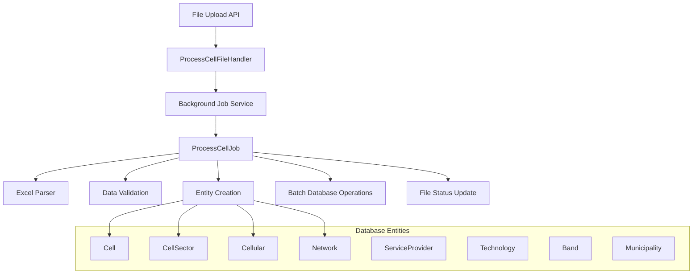
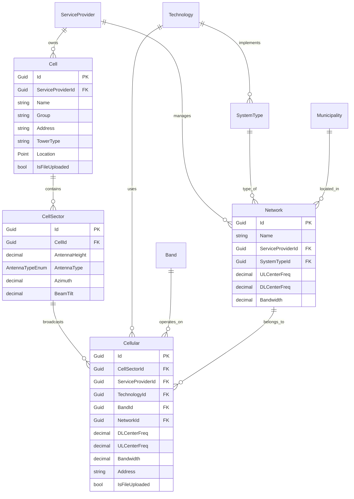

# ?? Cell Processing Workflow - Complete Documentation

## ?? Overview

The Cell Processing Workflow is a comprehensive background job system designed to process Excel files containing cellular network infrastructure data. This workflow transforms raw Excel data into structured database entities including Cells, CellSectors, Cellular records, and Networks while ensuring data integrity and performance optimization.

## ??? Architecture Overview

### **System Components**



### **Technology Stack**
- **.NET 8** - Core framework
- **Entity Framework Core** - ORM with PostgreSQL
- **NetTopologySuite** - Geospatial data handling
- **ClosedXML** - Excel file processing
- **Background Job Service** - Asynchronous processing
- **Structured Logging** - Comprehensive monitoring

## ?? File Structure & Components

### **Core Implementation**
```
NTC.QoS.Infrastructure/
??? BackgroundTasks/
?   ??? ProcessCellJob.cs                    # Main processing logic
?   ??? ProcessCellularCoverageJob.cs        # Coverage data processing
?   ??? ProcessNAPJob.cs                     # NAP infrastructure processing
?   ??? ProcessSpeedtestJob.cs               # Speed test data processing
??? Helper/
?   ??? CellExcelHelper.cs                   # Excel parsing utilities
?   ??? CacheKeyGenerator.cs                 # Cache key generation
?   ??? GeoQueryHelper.cs                    # Geospatial query utilities
??? Persistence/
    ??? ApplicationDbContext.cs               # Database context

NTC.QoS.Application/
??? Features/File/Handlers/Commands/
    ??? ProcessCellFileHandler.cs             # Entry point handler

NTC.QoS.Domain/
??? Interfaces/
?   ??? IProcessCellJob.cs                   # Job interface contract
??? Models/ExcelBindings/
?   ??? CellRecord.cs                        # Excel data binding model
??? Aggregates/
    ??? Cell.cs                              # Cell aggregate root
    ??? Network.cs                           # Network aggregate
    ??? ServiceProvider.cs                   # Service provider aggregate
```

## ?? Processing Workflow

### **Step 1: Job Initialization**

#### **File Upload & Job Triggering**
```csharp
public class ProcessCellFileHandler : IRequestHandler<ProcessCellFileRequest, bool>
{
    public Task<bool> Handle(ProcessCellFileRequest request, CancellationToken cancellationToken)
    {
        // Enqueue immediate processing
        backgroundJobService.Enqueue<IProcessCellJob>(job => 
            job.ExecuteAsync(request.File, cancellationToken));
        
        // Schedule cleanup after 1 day
        backgroundJobService.Schedule<IDeleteUploadedFileJob>(job => 
            job.ExecuteAsync(request.File, cancellationToken), TimeSpan.FromDays(1));
        
        return Task.FromResult(true);
    }
}
```

#### **Initial Validation & Status Update**
```csharp
// File validation and status setting
var file = await _fileRepository.FirstOrDefaultAsync(fileQuery, token);
if (file == null) throw new InvalidOperationException("File not found.");

file.Status = FileStatusEnum.Processing;
_fileRepository.Update(file);
await _fileRepository.SaveChangesAsync(token);
```

### **Step 2: Data Pre-loading & Caching**

The system implements comprehensive caching to optimize performance for large datasets:

#### **Service Provider Cache**
```csharp
var serviceProviderCache = await _serviceProviderRepository
    .Query(sp => sp.Service.Type == ServiceTypeEnum.Wireless)
    .Select(sp => new { sp.Id, sp.Provider.Name })
    .ToDictionaryAsync(
        sp => CacheKeyGenerator.GenerateServiceProviderCacheKey(sp.Name, ServiceTypeEnum.Wireless), 
        sp => sp.Id,
        token
    );
```

#### **Technology & Band Cache**
```csharp
var technologyCache = new Dictionary<string, Guid>();
var technologyList = await _technologyRepository
    .Query()
    .Select(t => new { t.Id, Technology = t.Standard })
    .ToListAsync(token);

foreach (var tech in technologyList)
{
    var key = CacheKeyGenerator.GenerateTechnologyCacheKey(tech.Technology);
    technologyCache[key] = tech.Id;
}
```

#### **Geospatial Municipality Cache**
```csharp
var municipalitiesWithBoundaries = await _municipalityRepository
    .Query(m => m.Boundaries != null)
    .Select(m => new { m.Id, m.Name, m.Boundaries })
    .ToListAsync(token);
```

#### **Existing Cell Cache with Duplicate Handling**
```csharp
var cellList = await _cellRepository
    .Query(c => providerIds.Contains(c.ServiceProviderId))
    .ToListAsync(token);

var cellCache = new Dictionary<string, Guid>();
var duplicateCount = 0;

foreach (var cell in cellList)
{
    var normalizedTowerType = string.IsNullOrWhiteSpace(cell.TowerType) ? "Unknown" : cell.TowerType;
    var key = CacheKeyGenerator.GenerateCellCacheKey(cell.ServiceProviderId, normalizedTowerType, cell.Location);
    
    if (!cellCache.TryGetValue(key, out Guid value))
    {
        cellCache[key] = cell.Id;
    }
    else
    {
        duplicateCount++;
        _logger.LogWarning("Duplicate cell cache key found: {Key}", key);
    }
}
```

### **Step 3: Excel File Processing**

#### **Excel Structure & Data Binding**
```csharp
public record CellRecord
{
    [ExcelHeader("Provider")] public string Provider { get; set; } = "";
    [ExcelHeader("Zone")] public string Zone { get; set; } = "";
    [ExcelHeader("Barangay")] public string Barangay { get; set; } = "";
    [ExcelHeader("Municipality")] public string Municipality { get; set; } = "";
    [ExcelHeader("Province")] public string Province { get; set; } = "";
    [ExcelHeader("Region")] public string Region { get; set; } = "";
    [ExcelHeader("Lat")] public double Latitude { get; set; }
    [ExcelHeader("Long")] public double Longitude { get; set; }
    
    // Technology/Band columns
    [ExcelHeader("900")] public string Gsm900 { get; set; } = "";
    [ExcelHeader("1800")] public string Gsm1800 { get; set; } = "";
    [ExcelHeader("850")] public string Wcdma850 { get; set; } = "";
    [ExcelHeader("900")] public string Wcdma900 { get; set; } = "";
    [ExcelHeader("2100")] public string Wcdma2100 { get; set; } = "";
    [ExcelHeader("700")] public string FddLte700 { get; set; } = "";
    [ExcelHeader("850")] public string FddLte850 { get; set; } = "";
    [ExcelHeader("900")] public string FddLte900 { get; set; } = "";
    [ExcelHeader("1800")] public string FddLte1800 { get; set; } = "";
    [ExcelHeader("2100")] public string FddLte2100 { get; set; } = "";
    [ExcelHeader("2300")] public string TddLte2300 { get; set; } = "";
    [ExcelHeader("2500")] public string TddLte2500 { get; set; } = "";
    [ExcelHeader("2600")] public string TddLte2600 { get; set; } = "";
    [ExcelHeader("3500")] public string Nr3500 { get; set; } = "";
    
    // Physical infrastructure
    [ExcelHeader("Tower Type")] public string TowerType { get; set; } = "";
    [ExcelHeader("Antenna Type")] public string AntennaType { get; set; } = "";
    [ExcelHeader("Antenna Height (m)")] public decimal AntennaHeight { get; set; }
    [ExcelHeader("Azimuth (°)")] public string Azimuth { get; set; } = "";
    [ExcelHeader("Beam Tilt (°)")] public string BeamTilt { get; set; } = "";
}
```

#### **Coordinate Validation & Correction**
```csharp
// TEMPORARY FIX: Handle coordinate swapping
if (record.Latitude > 50 && record.Longitude < 50)
{
    actualLatitude = record.Longitude;
    actualLongitude = record.Latitude;
    _logger.LogWarning("Detected swapped coordinates in Excel row {RowNumber}", recordIndex + 4);
}

location = GeometryHelper.CreatePoint(new Coordinate(y: actualLatitude, x: actualLongitude));
```

### **Step 4: Dynamic Technology/Band Processing**

#### **Property Reflection & Mapping**
```csharp
var bandTechnologyProperties = typeof(CellRecord).GetProperties()
    .Where(p => p.PropertyType == typeof(string))
    .Select(property => new
    {
        Property = property,
        HeaderAttribute = property.GetCustomAttribute<ExcelHeaderAttribute>(),
        Band = GetBandFromPropertyName(property.Name),
        Technology = GetTechnologyFromPropertyName(property.Name)
    })
    .Where(item => item.HeaderAttribute != null && 
                   !string.IsNullOrEmpty(item.Band) && 
                   !string.IsNullOrEmpty(item.Technology))
    .ToList();
```

#### **Band/Technology Column Value Parsing**
```csharp
private BandTechnologyParseResult ParseBandTechnologyValue(object? value, string technology, string band, int rowNumber)
{
    var result = new BandTechnologyParseResult();
    var stringValue = value?.ToString()?.Trim() ?? string.Empty;

    // Handle boolean values
    if (stringValue.Equals("TRUE", StringComparison.OrdinalIgnoreCase) || stringValue == "1")
    {
        result.IsActive = true;
        return result;
    }

    if (stringValue.Equals("FALSE", StringComparison.OrdinalIgnoreCase) || stringValue == "0")
    {
        result.IsActive = false;
        return result;
    }

    // Handle frequency format: CF: {decimal}, BW: {decimal}
    var pattern = @"CF:\s*([0-9]*\.?[0-9]+),\s*BW:\s*([0-9]*\.?[0-9]+)";
    var match = Regex.Match(stringValue, pattern, RegexOptions.IgnoreCase);

    if (match.Success)
    {
        result.IsActive = true;
        if (decimal.TryParse(match.Groups[1].Value, out var dlCenterFreq))
            result.DLCenterFreq = dlCenterFreq;
        if (decimal.TryParse(match.Groups[2].Value, out var bandwidth))
            result.Bandwidth = bandwidth;
        return result;
    }

    result.IsActive = false;
    return result;
}
```

### **Step 5: Entity Creation & Relationship Management**

#### **Cell Creation with Caching**
```csharp
var cellCacheKey = CacheKeyGenerator.GenerateCellCacheKey(serviceProviderId, 
    string.IsNullOrWhiteSpace(record.TowerType) ? "Unknown" : record.TowerType, location);

if (!cellCache.TryGetValue(cellCacheKey, out Guid cachedCellId))
{
    // Create new cell
    var cell = new Domain.Aggregates.Cell
    {
        Name = $"Cell-{record.Provider}-{address}-{record.TowerType}-{record.Longitude}-{record.Latitude}",
        Group = record.Provider,
        Address = address,
        ServiceProviderId = serviceProviderId,
        TowerType = string.IsNullOrWhiteSpace(record.TowerType) ? "Unknown" : record.TowerType,
        Location = location,
        IsFileUploaded = true,
    };
    cellsToAdd.Add(cell);
    cellId = cell.Id;
    cellCache[cellCacheKey] = cellId;
}
```

#### **Cell Sector Processing**
```csharp
if (!String.IsNullOrEmpty(record.Azimuth))
{
    var azimuths = record.Azimuth.Split(",", StringSplitOptions.RemoveEmptyEntries);
    var beamTilts = record.BeamTilt?.Split(',', StringSplitOptions.RemoveEmptyEntries);

    // Validation
    if (beamTilts == null || azimuths.Length != beamTilts.Length)
    {
        _logger.LogError("Azimuth/BeamTilt count mismatch in row {RowNumber}", actualRowNumber);
        await TerminateProcess(file, token);
        return;
    }

    for (int i = 0; i < azimuths.Length; i++)
    {
        if (decimal.TryParse(azimuths[i].Trim(), out decimal decimalAzimuth) &&
            decimal.TryParse(beamTilts[i].Trim(), out decimal decimalBeamTilt))
        {
            var cellSector = new Domain.Entities.CellSector
            {
                CellId = cellId,
                AntennaHeight = record.AntennaHeight,
                AntennaType = EnumHelper<AntennaTypeEnum>.ParseUserInput(record.AntennaType),
                Azimuth = decimalAzimuth,
                BeamTilt = decimalBeamTilt,
            };
            cellSectorList.Add(cellSector);
        }
    }
}
```

### **Step 6: Network Creation & Management**

#### **Dynamic Network Creation**
```csharp
private async Task<Guid> GetOrCreateNetworkAsync(
    Guid serviceProviderId, 
    string municipalityName,
    Guid technologyId, 
    Guid bandId,
    Dictionary<string, Guid> networkCache,
    List<Domain.Aggregates.Network> networksToAdd,
    Dictionary<string, Guid> technologyCache,
    Dictionary<string, Guid> bandCache,
    decimal dlCenterFreq,
    decimal ulCenterFreq,
    decimal bandwidth,
    CancellationToken token)
{
    var networkCacheKey = CacheKeyGenerator.GenerateNetworkCacheKey(
        serviceProviderId, municipalityName, technologyId, bandId);
    
    if (networkCache.TryGetValue(networkCacheKey, out var existingNetworkId))
        return existingNetworkId;

    // Check database
    var technologyName = technologyCache.FirstOrDefault(x => x.Value == technologyId).Key ?? "Unknown";
    var bandName = bandCache.FirstOrDefault(x => x.Value == bandId).Key ?? "Unknown";
    var networkNamePattern = $"{technologyName}-{bandName}-{municipalityName}";
    
    var existingNetwork = await _networkRepository
        .Query(n => n.ServiceProviderId == serviceProviderId && 
                   n.Name.StartsWith(networkNamePattern))
        .FirstOrDefaultAsync(token);

    if (existingNetwork != null)
    {
        networkCache[networkCacheKey] = existingNetwork.Id;
        return existingNetwork.Id;
    }

    // Create new network
    var systemType = await _systemTypeRepository
        .Query(st => st.TechnologyId == technologyId)
        .FirstOrDefaultAsync(token);

    if (systemType == null)
    {
        _logger.LogError("SystemType not found for Technology: {Technology}", technologyName);
        return Guid.Empty;
    }

    var network = new Domain.Aggregates.Network
    {
        Name = $"{technologyName}-{bandName}-{municipalityName}",
        ServiceProviderId = serviceProviderId,
        SystemTypeId = systemType.Id,
        ULCenterFreq = ulCenterFreq,
        DLCenterFreq = dlCenterFreq,
        Bandwidth = bandwidth
    };

    networksToAdd.Add(network);
    networkCache[networkCacheKey] = network.Id;
    return network.Id;
}
```

### **Step 7: Frequency Calculation & Technology Support**

#### **Duplex Frequency Calculation**
```csharp
private decimal CalculateULCenterFreq(decimal dlCenterFreq, string technology, string band)
{
    // TDD technologies use same frequency for UL and DL
    if (technology.Contains("TDD", StringComparison.OrdinalIgnoreCase) || 
        (technology.Equals("NR", StringComparison.OrdinalIgnoreCase) && IsTDDBand(band)))
    {
        return dlCenterFreq;
    }

    // FDD technologies use different frequencies
    return technology.ToUpperInvariant() switch
    {
        "GSM" => CalculateGsmULFreq(dlCenterFreq, band),
        "EDGE" => CalculateGsmULFreq(dlCenterFreq, band),
        "WCDMA" => CalculateWcdmaULFreq(dlCenterFreq, band),
        "HSPAP" => CalculateWcdmaULFreq(dlCenterFreq, band),
        "FDDLTE" => CalculateLteFddULFreq(dlCenterFreq, band),
        "LTE" => CalculateLteFddULFreq(dlCenterFreq, band),
        "NR" => CalculateNrFddULFreq(dlCenterFreq, band),
        _ => dlCenterFreq
    };
}
```

#### **Default Frequency Assignment**
```csharp
private static decimal GetDefaultDLCenterFreq(string technology, string band)
{
    return (technology.ToUpperInvariant(), band) switch
    {
        ("GSM", "Band 8") => 947.5m,     // 900 MHz GSM center
        ("GSM", "Band 3") => 1842.5m,    // 1800 MHz GSM center
        ("WCDMA", "Band 5") => 869m,     // 850 MHz WCDMA center
        ("WCDMA", "Band 8") => 950m,     // 900 MHz WCDMA center
        ("WCDMA", "Band 1") => 2140m,    // 2100 MHz WCDMA center
        ("FDDLTE", "Band 28") => 758m,   // 700 MHz LTE center
        ("FDDLTE", "Band 5") => 869m,    // 850 MHz LTE center
        ("FDDLTE", "Band 8") => 950m,    // 900 MHz LTE center
        ("FDDLTE", "Band 3") => 1842.5m, // 1800 MHz LTE center
        ("FDDLTE", "Band 1") => 2140m,   // 2100 MHz LTE center
        ("TDDLTE", "Band 40") => 2300m,  // 2300 MHz TDD center
        ("TDDLTE", "Band 41") => 2500m,  // 2500 MHz TDD center
        ("NR", "Band 78") => 3500m,      // 3500 MHz NR center
        _ => DEFAULT_DL_CENTER_FREQ       // Fallback to 0
    };
}
```

### **Step 8: Cellular Entity Creation & Management**

#### **Cellular Record Processing**
```csharp
foreach (var propInfo in bandTechnologyProperties)
{
    var parseResult = ParseBandTechnologyValue(value, propInfo.Technology, propInfo.Band, actualRowNumber);
    
    if (cellularLookup.TryGetValue((cellId, serviceProviderId, technologyId, bandId), out var existingCellular))
    {
        if (!parseResult.IsActive)
        {
            cellularToDelete.Add(existingCellular);
        }
        else
        {
            // Update existing cellular with new frequency data
            if (parseResult.DLCenterFreq.HasValue)
            {
                existingCellular.DLCenterFreq = parseResult.DLCenterFreq.Value;
                existingCellular.ULCenterFreq = CalculateULCenterFreq(
                    parseResult.DLCenterFreq.Value, propInfo.Technology, propInfo.Band);
            }
            if (parseResult.Bandwidth.HasValue)
            {
                existingCellular.Bandwidth = parseResult.Bandwidth.Value;
            }
            _cellularRepository.Update(existingCellular);
        }
    }
    else if (parseResult.IsActive)
    {
        // Create new cellular records for all sectors
        foreach (var sectorId in allSectorIds)
        {
            var dlCenterFreq = parseResult.DLCenterFreq ?? GetDefaultDLCenterFreq(propInfo.Technology, propInfo.Band);
            var bandwidth = parseResult.Bandwidth ?? GetDefaultBandwidth(propInfo.Technology, propInfo.Band);
            var ulCenterFreq = CalculateULCenterFreq(dlCenterFreq, propInfo.Technology, propInfo.Band);

            var networkId = await GetOrCreateNetworkAsync(/* parameters */);

            var newCellular = new Domain.Entities.Cellular
            {
                CellSectorId = sectorId,
                ServiceProviderId = serviceProviderId,
                TechnologyId = technologyId,
                BandId = bandId,
                NetworkId = networkId,
                Address = address,
                IsFileUploaded = true,
                DLCenterFreq = dlCenterFreq,
                Bandwidth = bandwidth,
                ULCenterFreq = ulCenterFreq
            };

            cellularToAdd.Add(newCellular);
        }
    }
}
```

### **Step 9: Data Validation & Completeness Check**

#### **Missing Cellular Entity Validation**
```csharp
private async Task ValidateAndCreateMissingCellularEntities(/* parameters */)
{
    var missingCellularCount = 0;
    var skippedDuetoMissingLocation = 0;
    var skippedDuetoMissingNetworkDependencies = 0;

    // Build set of ACTIVE technology/band combinations from Excel
    var activeTechBandCombinations = new HashSet<(Guid TechnologyId, Guid BandId)>();
    
    foreach (var record in cellRecords)
    {
        foreach (var propInfo in bandTechnologyProperties)
        {
            var value = propInfo.Property.GetValue(record);
            var parseResult = ParseBandTechnologyValue(value, propInfo.Technology, propInfo.Band, 0);

            if (parseResult.IsActive)
            {
                if (technologyCache.TryGetValue(technologyCacheKey, out var technologyId) &&
                    bandCache.TryGetValue(bandCacheKey, out var bandId))
                {
                    activeTechBandCombinations.Add((technologyId, bandId));
                }
            }
        }
    }

    // Validate each cell has cellular entities for all active combinations
    foreach (var cell in cellsWithProviders)
    {
        var (municipalityId, municipalityName) = GetMunicipalityByLocationOptimized(
            cell.Location, municipalitiesWithBoundaries);

        if (string.IsNullOrEmpty(municipalityName) || municipalityName == "Unknown")
        {
            skippedDuetoMissingLocation++;
            continue;
        }

        foreach (var cellSectorId in cellSectorIds)
        {
            foreach (var (techId, bandId) in activeTechBandCombinations)
            {
                var key = (cellSectorId, cell.ServiceProviderId, techId, bandId);

                if (!cellularLookup.ContainsKey(key))
                {
                    // Create missing cellular entity with defaults
                    var networkId = await GetOrCreateNetworkAsync(/* parameters */);
                    
                    if (networkId == Guid.Empty)
                    {
                        skippedDuetoMissingNetworkDependencies++;
                        continue;
                    }

                    var newCellular = new Domain.Entities.Cellular
                    {
                        CellSectorId = cellSectorId,
                        ServiceProviderId = cell.ServiceProviderId,
                        TechnologyId = techId,
                        BandId = bandId,
                        NetworkId = networkId,
                        Address = cell.Address ?? "",
                        IsFileUploaded = false, // System-created
                        DLCenterFreq = GetDefaultDLCenterFreq(technology, band),
                        Bandwidth = GetDefaultBandwidth(technology, band),
                        ULCenterFreq = CalculateULCenterFreq(defaultDLCenterFreq, technology, band)
                    };

                    cellularToAdd.Add(newCellular);
                    missingCellularCount++;
                }
            }
        }
    }

    _logger.LogInformation("=== CELLULAR VALIDATION SUMMARY ===");
    _logger.LogInformation("Missing cellular entities created: {CreatedCount}", missingCellularCount);
    _logger.LogInformation("Cells skipped due to missing municipality: {SkippedLocationCount}", skippedDuetoMissingLocation);
    _logger.LogInformation("Cellular entities skipped due to missing dependencies: {SkippedDependencyCount}", skippedDuetoMissingNetworkDependencies);
}
```

### **Step 10: Batch Database Operations**

#### **Optimized Bulk Operations**
```csharp
// Batch add new networks (before cellular records since they depend on networks)
if (networksToAdd.Count != 0)
{
    await _networkRepository.BulkInsertAsync(networksToAdd, token);
    _logger.LogInformation("{Count} new networks saved successfully (batched).", networksToAdd.Count);
}

// Batch add new cells
if (cellsToAdd.Count != 0)
{
    await _cellRepository.BulkInsertAsync(cellsToAdd, token);
    _logger.LogInformation("{Count} new cells saved successfully (batched).", cellsToAdd.Count);
}

// Batch add new cell sectors
if (cellSectorList.Count != 0)
{
    await _cellSectorRepository.BulkInsertAsync(cellSectorList, token);
    _logger.LogInformation("{Count} sector records saved successfully (batched).", cellSectorList.Count);
    
    // Update cache with newly created sectors
    foreach (var sector in cellSectorList)
    {
        if (!cellSectorCache.ContainsKey(sector.CellId))
            cellSectorCache[sector.CellId] = new List<Guid>();
        cellSectorCache[sector.CellId].Add(sector.Id);
    }
}

// Batch add new cellular entries
if (cellularToAdd.Count != 0)
{
    await _cellularRepository.BulkInsertAsync(cellularToAdd, token);
    _logger.LogInformation("{Count} cellular records saved successfully (batched).", cellularToAdd.Count);
}

// Batch delete cellular entries
if (cellularToDelete.Count != 0)
{
    await _cellularRepository.BulkDeleteAsync(cellularToDelete);
    _logger.LogInformation("{Count} cellular records deleted successfully (batched).", cellularToDelete.Count);
}
```

## ?? Data Models & Relationships

### **Core Entity Relationships**



### **Excel Data Binding Model**

```csharp
public record CellRecord
{
    // Location Information
    [ExcelHeader("Provider")] public string Provider { get; set; } = "";
    [ExcelHeader("Zone")] public string Zone { get; set; } = "";
    [ExcelHeader("Barangay")] public string Barangay { get; set; } = "";
    [ExcelHeader("Municipality")] public string Municipality { get; set; } = "";
    [ExcelHeader("Province")] public string Province { get; set; } = "";
    [ExcelHeader("Region")] public string Region { get; set; } = "";
    [ExcelHeader("Lat")] public double Latitude { get; set; }
    [ExcelHeader("Long")] public double Longitude { get; set; }

    // Technology/Band Coverage (Dynamic)
    [ExcelHeader("900")] public string Gsm900 { get; set; } = "";
    [ExcelHeader("1800")] public string Gsm1800 { get; set; } = "";
    [ExcelHeader("850")] public string Wcdma850 { get; set; } = "";
    [ExcelHeader("900")] public string Wcdma900 { get; set; } = "";
    [ExcelHeader("2100")] public string Wcdma2100 { get; set; } = "";
    [ExcelHeader("700")] public string FddLte700 { get; set; } = "";
    [ExcelHeader("850")] public string FddLte850 { get; set; } = "";
    [ExcelHeader("900")] public string FddLte900 { get; set; } = "";
    [ExcelHeader("1800")] public string FddLte1800 { get; set; } = "";
    [ExcelHeader("2100")] public string FddLte2100 { get; set; } = "";
    [ExcelHeader("2300")] public string TddLte2300 { get; set; } = "";
    [ExcelHeader("2500")] public string TddLte2500 { get; set; } = "";
    [ExcelHeader("2600")] public string TddLte2600 { get; set; } = "";
    [ExcelHeader("3500")] public string Nr3500 { get; set; } = "";

    // Physical Infrastructure
    [ExcelHeader("Tower Type")] public string TowerType { get; set; } = "";
    [ExcelHeader("Antenna Type")] public string AntennaType { get; set; } = "";
    [ExcelHeader("Antenna Height (m)")] public decimal AntennaHeight { get; set; }
    [ExcelHeader("Azimuth (°)")] public string Azimuth { get; set; } = "";
    [ExcelHeader("Beam Tilt (°)")] public string BeamTilt { get; set; } = "";
}
```

## ?? Configuration & Constants

### **Default Values**
```csharp
// Frequency defaults when not specified
private const decimal DEFAULT_DL_CENTER_FREQ = 0;
private const decimal DEFAULT_UL_CENTER_FREQ = 0;
private const decimal DEFAULT_BANDWIDTH = 20; // 20 MHz default bandwidth

// Technology-specific defaults
private static decimal GetDefaultBandwidth(string technology, string band)
{
    return technology.ToUpperInvariant() switch
    {
        "GSM" => 0.2m,       // 200 kHz
        "EDGE" => 0.2m,      // 200 kHz (GSM-based)
        "WCDMA" => 5m,       // 5 MHz
        "HSPAP" => 5m,       // 5 MHz (WCDMA-based)
        "FDDLTE" => 20m,     // 20 MHz
        "TDDLTE" => 20m,     // 20 MHz
        "LTE" => 20m,        // 20 MHz (generic LTE)
        "NR" => 100m,        // 100 MHz for 5G
        _ => DEFAULT_BANDWIDTH // 20 MHz default
    };
}
```

### **Band Mapping Configuration**
```csharp
private static string GetBandFromPropertyName(string propertyName)
{
    if (propertyName.Contains("700")) return "Band 28";
    if (propertyName.Contains("850")) return "Band 5";
    if (propertyName.Contains("900")) return "Band 8";
    if (propertyName.Contains("1800")) return "Band 3";
    if (propertyName.Contains("2100")) return "Band 1";
    if (propertyName.Contains("2300")) return "Band 40";
    if (propertyName.Contains("2500")) return "Band 41";
    if (propertyName.Contains("2600")) return "Band 38";
    if (propertyName.Contains("3400")) return "Band 42";
    if (propertyName.Contains("3500")) return "Band 78";
    return string.Empty;
}

private static string GetTechnologyFromPropertyName(string propertyName)
{
    if (propertyName.StartsWith("Gsm")) return "GSM";
    if (propertyName.StartsWith("Wcdma")) return "WCDMA";
    if (propertyName.StartsWith("FddLte")) return "FDDLTE";
    if (propertyName.StartsWith("TddLte")) return "TDDLTE";
    if (propertyName.StartsWith("Nr")) return "NR";
    return string.Empty;
}
```

## ?? Error Handling & Validation

### **Critical Error Handling**
```csharp
private async Task TerminateProcess(Domain.Entities.File file, CancellationToken cancellationToken)
{
    file.Status = FileStatusEnum.Failed;
    _fileRepository.Update(file);
    await _fileRepository.SaveChangesAsync(cancellationToken);
    
    _logger.LogError("=== PROCESSING TERMINATED DUE TO MISSING DEPENDENCIES ===");
    _logger.LogError("File processing has been terminated because required database entities are missing.");
    _logger.LogError("Please ensure the following entities exist in your database before re-uploading the file:");
    _logger.LogError("1. SERVICE PROVIDERS: All providers mentioned in your Excel file must exist as 'Wireless' service providers");
    _logger.LogError("2. TECHNOLOGIES: All technologies (GSM, WCDMA, LTE-FDD, LTE-TDD, NR, etc.) must exist in the Technologies table");
    _logger.LogError("3. BANDS: All bands (Band 28, Band 5, Band 8, Band 3, etc.) must exist in the Bands table");
    _logger.LogError("4. SYSTEM TYPES: Each technology must have a corresponding SystemType entry");
    _logger.LogError("5. LINKS: Each ServiceProvider + Band combination must have both Uplink and Downlink entries");
}
```

### **Validation Checkpoints**

#### **1. File Existence & Access**
```csharp
var file = await _fileRepository.FirstOrDefaultAsync(fileQuery, token);
if (file == null)
{
    const string message = "File not found.";
    _logger.LogError(message);
    throw new InvalidOperationException(message);
}
```

#### **2. Service Provider Validation**
```csharp
if (!serviceProviderCache.TryGetValue(spCacheKey, out var serviceProviderId))
{
    _logger.LogWarning("Wireless Service Provider not found: {Provider}. Terminating process.", record.Provider);
    await TerminateProcess(file, token);
    return;
}
```

#### **3. Technology & Band Validation**
```csharp
if (!technologyCache.TryGetValue(technologyCacheKey, out var technologyId))
{
    // Try flexible lookup for TDD/FDD technologies
    if (propInfo.Technology.Contains("TDD", StringComparison.OrdinalIgnoreCase))
    {
        var tddTechnology = technologyCache.FirstOrDefault(kvp => 
            kvp.Key.Contains("tdd", StringComparison.OrdinalIgnoreCase));
        if (tddTechnology.Key != null)
        {
            technologyId = tddTechnology.Value;
        }
    }
    // ... similar logic for FDD and alternative mappings
    
    if (technologyId == Guid.Empty)
    {
        _logger.LogError("CRITICAL ERROR: Technology '{Technology}' not found in database.", propInfo.Technology);
        await TerminateProcess(file, token);
        return;
    }
}
```

#### **4. Coordinate Validation**
```csharp
// Detect and correct swapped coordinates
if (record.Latitude > 50 && record.Longitude < 50)
{
    actualLatitude = record.Longitude;
    actualLongitude = record.Latitude;
    _logger.LogWarning("Detected swapped coordinates in Excel row {RowNumber}", recordIndex + 4);
}
```

#### **5. Azimuth/BeamTilt Validation**
```csharp
if (beamTilts == null || azimuths.Length != beamTilts.Length)
{
    _logger.LogError("The number of Azimuth values does not match BeamTilt values for row {RowNumber}", actualRowNumber);
    await TerminateProcess(file, token);
    return;
}
```

## ?? Performance Optimizations

### **1. Caching Strategy**
- **Pre-load all reference data** before processing
- **Dictionary-based lookups** for O(1) access
- **Duplicate handling** for data integrity
- **Spatial query optimization** with pre-loaded municipalities

### **2. Batch Operations**
- **Bulk inserts** for all entity types
- **Batch size optimization** for memory management
- **Dependency-ordered operations** (Networks ? Cells ? CellSectors ? Cellular)

### **3. Memory Management**
- **Streaming Excel processing** to avoid loading entire file in memory
- **Incremental entity creation** with list accumulation
- **Efficient caching** with appropriate data structures

### **4. Database Optimization**
- **Spatial indexing** on location columns (GIST indexes)
- **Foreign key optimization** with pre-validated IDs
- **Bulk operations** to minimize database round trips

## ?? Monitoring & Logging

### **Progress Reporting**
```csharp
void ReportProgress(string message)
{
    _logger.LogInformation(message);
}

// Usage throughout processing
ReportProgress($"Processing record from Excel row {actualRowNumber}: {record.Provider}");
ReportProgress($"Processed {totalProcessed}/{napRecords.Count} records ({percentage:F1}%)");
```

### **Comprehensive Logging**
```csharp
// Performance metrics
_logger.LogInformation("Pre-loaded {Count} wireless service providers.", serviceProviderCache.Count);
_logger.LogInformation("Pre-loaded {Count} technologies: {Technologies}", technologyCache.Count, technologiesList);
_logger.LogInformation("Pre-loaded {Count} existing cells ({DuplicateCount} duplicates handled)", cellCache.Count, duplicateCount);

// Processing status
_logger.LogInformation("Found {CellCount} cells and {NAPCount} NAPs within {Radius}m", cellCount, napCount, radius);
_logger.LogInformation("Successfully processed point broadband info. Summary: {TotalCells} cells", totalCells);

// Error tracking
_logger.LogWarning("Could not parse '{Value}' as decimal for row {RowNumber}", value, rowNumber);
_logger.LogError("CRITICAL ERROR: Technology '{Technology}' not found in database", technology);
```

### **Summary Reporting**
```csharp
_logger.LogInformation("=== CELLULAR VALIDATION SUMMARY ===");
_logger.LogInformation("Total cells processed: {TotalCells}", cellsWithProviders.Count);
_logger.LogInformation("Missing cellular entities created: {CreatedCount}", missingCellularCount);
_logger.LogInformation("Cells skipped due to missing municipality: {SkippedLocationCount}", skippedDuetoMissingLocation);
_logger.LogInformation("Processing completed successfully. " +
    "Technologies: {TechCount}, Bands: {BandCount}, Networks: {NetworkCount}",
    technologyCache.Count, bandCache.Count, networkCache.Count);
```

## ?? Related Workflows

The cell processing workflow is part of a larger ecosystem of background jobs:

### **1. ProcessNAPJob** - NAP Infrastructure Processing
- Processes Network Access Point data
- Handles ISP infrastructure mapping
- Implements similar caching and validation strategies

### **2. ProcessSpeedtestJob** - Speed Test Data Processing  
- Processes cellular speed test measurements
- Links to existing cell infrastructure
- Provides performance metrics for coverage analysis

### **3. ProcessCellularCoverageJob** - Coverage Data Processing
- Processes coverage strength measurements
- Links to existing network infrastructure
- Provides signal quality mapping

### **4. DeleteUploadedFileJob** - Cleanup Operations
- Scheduled cleanup of processed files
- Maintains storage efficiency
- Configurable retention policies

## ?? Configuration Requirements

### **Database Dependencies**
Before processing any cell data, ensure the following reference data exists:

#### **1. Service Providers**
```sql
-- Must exist as 'Wireless' service providers
INSERT INTO ServiceProviders (Id, ServiceId, ProviderId) 
SELECT NEWID(), s.Id, p.Id 
FROM Services s, Providers p 
WHERE s.Type = 'Wireless' AND p.Name IN ('Smart', 'Globe', 'DITO', 'Sun');
```

#### **2. Technologies**
```sql
-- Must include all technologies used in Excel
INSERT INTO Technologies (Id, Standard, GenerationId) VALUES
(NEWID(), 'GSM', @2GId),
(NEWID(), 'EDGE', @2GId),
(NEWID(), 'WCDMA', @3GId),
(NEWID(), 'HSPAP', @3GId),
(NEWID(), 'FDDLTE', @4GId),
(NEWID(), 'TDDLTE', @4GId),
(NEWID(), 'LTE', @4GId),
(NEWID(), 'NR', @5GId);
```

#### **3. Bands**
```sql
-- Must include all bands referenced in Excel
INSERT INTO Bands (Id, Name, FrequencyRange) VALUES
(NEWID(), 'Band 28', '700 MHz'),
(NEWID(), 'Band 5', '850 MHz'),
(NEWID(), 'Band 8', '900 MHz'),
(NEWID(), 'Band 3', '1800 MHz'),
(NEWID(), 'Band 1', '2100 MHz'),
(NEWID(), 'Band 40', '2300 MHz'),
(NEWID(), 'Band 41', '2500 MHz'),
(NEWID(), 'Band 38', '2600 MHz'),
(NEWID(), 'Band 78', '3500 MHz');
```

#### **4. System Types**
```sql
-- Each technology must have corresponding system type
INSERT INTO SystemTypes (Id, Name, TechnologyId) 
SELECT NEWID(), t.Standard, t.Id 
FROM Technologies t;
```

#### **5. Geographic Boundaries**
```sql
-- Municipalities must have boundary data for spatial queries
UPDATE Municipalities SET Boundaries = ST_GeomFromText('POLYGON(...)', 4326) 
WHERE Boundaries IS NULL;
```

## ?? Usage Examples

### **Excel File Format Requirements**

#### **Minimum Required Columns:**
- Provider, Zone, Barangay, Municipality, Province, Region
- Lat, Long (coordinate data)
- At least one technology/band combination column
- Tower Type, Antenna Type, Antenna Height
- Azimuth, Beam Tilt (sector configuration)

#### **Technology/Band Column Values:**
- **Boolean**: `TRUE`/`FALSE` or `1`/`0`
- **Frequency Data**: `CF: 2140.5, BW: 20` (Center Frequency + Bandwidth)
- **Empty**: Defaults to `FALSE` (inactive)

#### **Sample Excel Structure:**
```
Provider | Zone | Barangay | Municipality | Province | Region | Lat | Long | 900 | 1800 | 850 | 2100 | Tower Type | Antenna Type | Height | Azimuth | Beam Tilt
Smart | Zone1 | Brgy1 | Manila | NCR | NCR | 14.5995 | 120.9842 | TRUE | CF: 1842.5, BW: 10 | FALSE | TRUE | Monopole | Panel | 30 | 0,120,240 | 3,3,3
Globe | Zone2 | Brgy2 | Quezon | NCR | NCR | 14.6760 | 121.0437 | FALSE | TRUE | TRUE | CF: 2140, BW: 20 | Lattice | Sector | 45 | 30,150,270 | 2,2,2
```

### **API Integration**
```csharp
// Trigger cell processing via API
[HttpPost("files/{fileId}/process-cells")]
public async Task<IActionResult> ProcessCellFile(Guid fileId)
{
    var request = new ProcessCellFileRequest { File = new FileDto { Id = fileId, Path = filePath } };
    var result = await _mediator.Send(request);
    return Ok(new { Success = result, Message = "Cell processing job queued successfully" });
}
```

## ?? Troubleshooting Guide

### **Common Issues & Solutions**

#### **1. Missing Service Provider Error**
```
ERROR: Wireless Service Provider not found: {Provider}
```
**Solution**: Ensure the provider exists in the database with `ServiceType = Wireless`

#### **2. Technology Not Found Error**
```
ERROR: Technology 'FDDLTE' not found in database
```
**Solution**: Add the technology to the Technologies table or check naming conventions

#### **3. Coordinate Validation Issues**
```
WARNING: Detected swapped coordinates in Excel row {RowNumber}
```
**Solution**: Verify Lat/Long column order in Excel file

#### **4. Azimuth/BeamTilt Mismatch**
```
ERROR: Azimuth/BeamTilt count mismatch in row {RowNumber}
```
**Solution**: Ensure equal number of comma-separated values in both columns

#### **5. Network Creation Failure**
```
ERROR: SystemType not found for Technology: {Technology}
```
**Solution**: Ensure SystemType records exist for all technologies

### **Performance Troubleshooting**

#### **Memory Issues**
- Monitor batch sizes and adjust if needed
- Verify bulk operations are being used
- Check for memory leaks in long-running processes

#### **Database Performance**
- Ensure spatial indexes exist on location columns
- Monitor query execution plans for optimization opportunities
- Consider database connection pooling optimization

## ?? Future Enhancements

### **Planned Improvements**

#### **1. Real-time Processing**
- Stream processing for large files
- Progress reporting via SignalR
- Cancellation support for long-running jobs

#### **2. Advanced Validation**
- RF engineering rule validation
- Coverage overlap detection
- Interference analysis

#### **3. Data Quality Enhancements**
- Duplicate detection algorithms
- Data quality scoring
- Automated data correction suggestions

#### **4. Integration Improvements**
- External system integration APIs
- Automated reference data synchronization
- Multi-format file support (CSV, JSON, XML)

## ?? Related Documentation

- **[Analytics Handlers Documentation](ANALYSIS-AreaBroadbandInfoHandler-UI-Support.md)** - Geographic analysis workflows
- **[Performance Optimization Guide](PERFORMANCE-OPTIMIZED-LOGO-DATA-SOLUTION.md)** - Caching and optimization strategies
- **[Code Quality Standards](CODE-DUPLICATION-ELIMINATION-SUMMARY.md)** - Development best practices

---

*This documentation represents the complete cell processing workflow as of the current implementation. For the latest updates and modifications, refer to the source code and commit history.*