# Process Connectivity Assessment Job - Detailed Process Flow

## Overview
The ProcessConnectivityAssessmentJob is a Hangfire background job that generates connectivity assessments for geographic locations (Region, Province, Municipality, Barangay) by calculating infrastructure statistics, speed test metrics, and CMTS scores.

---

## 1. Main Job Execution Flow

### Purpose
Orchestrates the entire connectivity assessment process from location discovery to database persistence.

### Process Flow Diagram

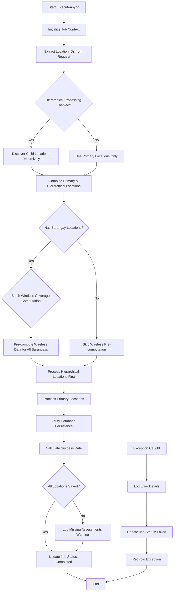

### Detailed Steps

#### Phase 1: Initialization
1. Extract job ID, user ID, and start time
2. Parse location IDs and types from request
3. Initialize progress tracking variables

#### Phase 2: Location Discovery
- If hierarchical processing enabled:
  - Discover all child locations up to specified depth
  - Build complete location hierarchy (Region → Province → Municipality → Barangay)
- Group locations by type

#### Phase 3: Wireless Coverage Pre-computation
- If barangays are present:
  - Load all barangay boundaries and metadata
  - Call `WirelessCoverageComputationService.ComputeBatchWirelessCoverageAsync()`
  - Store results in dictionary for fast lookup during processing
- Why? Prevents repeated wireless queries for each barangay

#### Phase 4: Batch Processing
- Process hierarchical locations first (if any)
- Process primary locations second
- Each processing call handles its own batching and persistence

#### Phase 5: Verification & Completion
- Verify all expected assessments exist in database
- Calculate success rate and log discrepancies
- Update job status and duration

---

## 2. Location Processing (ProcessLocationsSequentially)

### Purpose
Processes locations in batches with optimized persistence and progress tracking.

### Process Flow Diagram

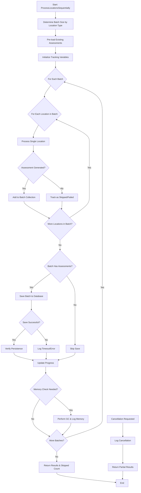

### Batch Size Configuration

| Location Type | Batch Size | Rationale |
|--------------|-----------|-----------|
| Regional | 1 | Very large spatial queries, 1K-4K children |
| Provincial | 1 | Reduced for timeout prevention |
| Municipality | 1 | Faster commits, timeout prevention |
| Barangay | 3 | Leaf level, most numerous |

### Key Features

1. **Optimistic vs Pessimistic Counting**
   - Processing count: Items processed (optimistic)
   - Saved count: Items persisted (pessimistic, verified)

2. **Batch Persistence Strategy**
   - Accumulate assessments in memory
   - Save entire batch in single transaction
   - Verify database write success
   - Track failures for reporting

3. **Progress Reporting**
   - Report every 5 items for smooth UI updates
   - Calculate processing rate (items/sec)
   - Estimate time remaining

4. **Memory Management**
   - Check memory every 5 batches
   - Force garbage collection when needed
   - Log memory usage for monitoring

---

## 3. Single Location Processing (ProcessSingleLocationForBatch)

### Purpose
Generates or updates assessment for a single location with deferred persistence.

### Process Flow Diagram

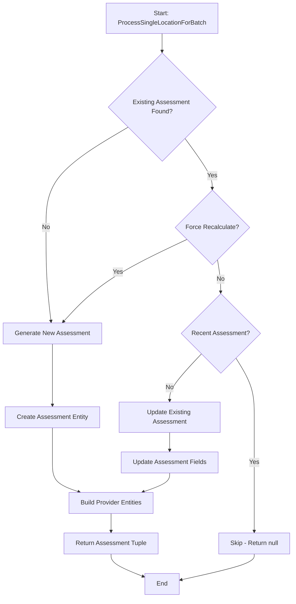

### Assessment Generation Steps

1. Check for existing assessment in pre-loaded cache
2. Determine if recalculation needed
3. If new assessment:
   - Call `GenerateNewAssessment()`
   - Create providers list
4. If update:
   - Call `UpdateExistingAssessment()`
   - Rebuild providers list
5. Return (Assessment, Providers, LocationName) tuple

---

## 4. Assessment Generation (GenerateNewAssessment)

### Purpose
Computes complete connectivity assessment with all CMTS components.

### Process Flow Diagram

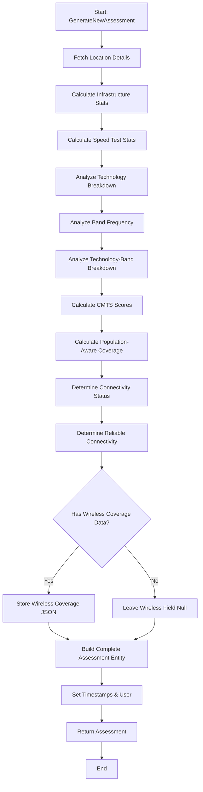

### Data Collection Sequence

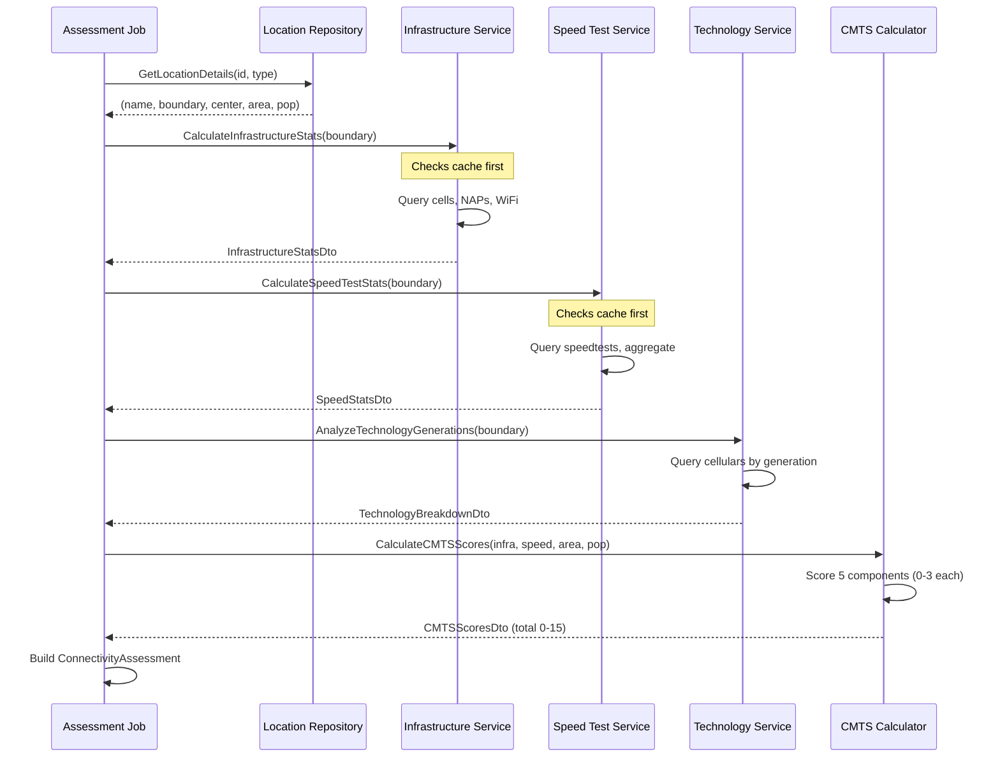

---

## 5. Infrastructure Statistics Calculation

### Purpose
Calculates accurate infrastructure asset counts using optimized spatial queries.

### Process Flow Diagram

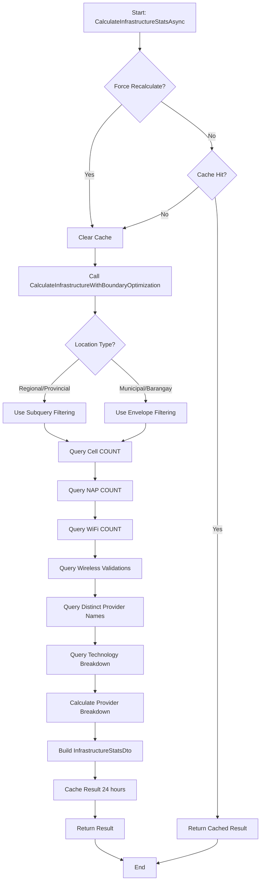

### Query Optimization Strategy

**Regional/Provincial (Large Areas)**
- Uses: Subquery-based boundary filtering
- No geometry materialization
- Prevents timeout on complex boundaries
- Example:
  ```sql
  WHERE location.Within(
    (SELECT boundary FROM regions WHERE id = @regionId)
  )
  ```

**Municipal/Barangay (Small Areas)**
- Uses: Envelope filtering
- Single boundary materialization
- Faster for simple geometries
- Example:
  ```sql
  WHERE location.Within(@boundary)
  AND location.Intersects(@envelope)
  ```

---

## 6. Speed Test Statistics Calculation

### Purpose
Aggregates speed test data with database-level calculations to avoid memory exhaustion.

### Process Flow Diagram

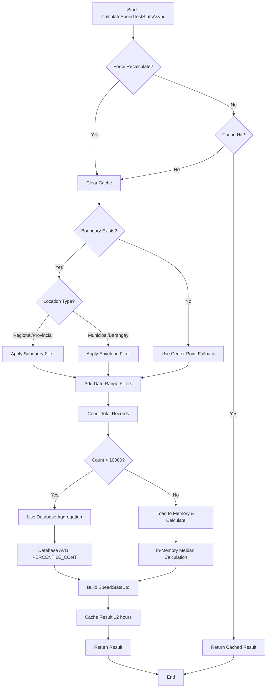

### Database Aggregation (Large Datasets)

For regions with millions of speedtest records:
- Uses `AVG()` for averages
- Uses `PERCENTILE_CONT(0.5)` for median approximation
- Prevents PostgreSQL shared memory exhaustion (Error 53100)
- All calculations stay in database

---

## 7. CMTS Scoring System

### Purpose
Calculates 5-component Connectivity Maturity and Technology Score (0-15 total points).

### CMTS Components

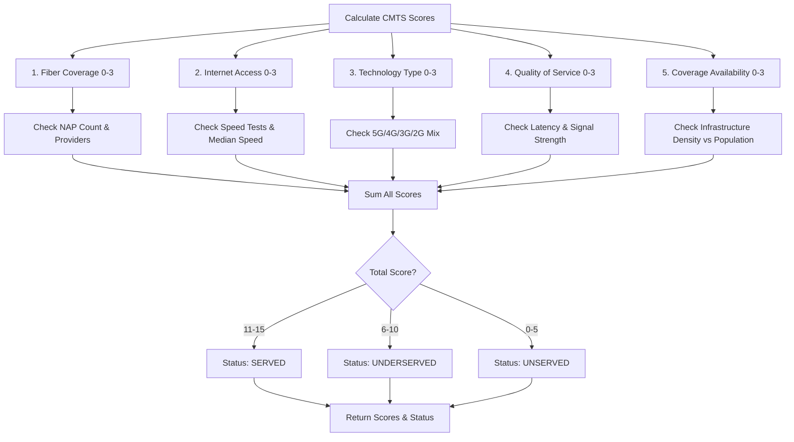

### Scoring Logic

#### 1. Fiber Coverage (0-3 points)
- 3 points: Multiple major telcos (Globe, Smart, DITO)
- 2 points: 1 major telco present
- 1 point: Local/VAS providers only
- 0 points: No fiber infrastructure

#### 2. Internet Access (0-3 points)
- 3 points: Median ≥25 Mbps, reliable
- 2 points: Median ≥25 Mbps, unreliable OR ≥10 Mbps reliable
- 1 point: Median ≥10 Mbps, unreliable
- 0 points: <10 Mbps or no data

#### 3. Technology Type (0-3 points)
- 3 points: Fiber OR 5G present
- 2 points: 4G present, not legacy-dominated
- 1 point: Modern tech present but legacy-dominated
- 0 points: Only 2G/3G

#### 4. Quality of Service (0-3 points)
- 3 points: 5G + low latency (≤20ms) + high speed (≥100 Mbps)
- 2 points: Low latency + good signal + consistent speeds
- 1 point: Some quality indicators met
- 0 points: High latency (>100ms) or poor signal

#### 5. Coverage Availability (0-3 points)
- 3 points: ≥100% estimated population coverage
- 2 points: 40-99% estimated population coverage
- 1 point: <40% estimated population coverage
- 0 points: No infrastructure

### Coverage Estimation Formula

```
Coverage = (TotalAssets × CoverageRadiusPerAsset) / Population

Where:
- Urban areas: 500 people per asset
- High density: 1000 people per asset
- Rural: 2000 people per asset
```

---

## 8. Batch Save Process

### Purpose
Persists assessments to database with transaction safety and verification.

### Process Flow Diagram

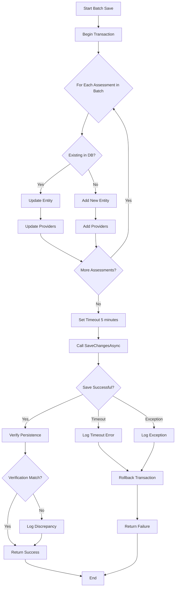

### Timeout Handling

- **Batch Save Timeout**: 300 seconds (5 minutes)
- **Verification Timeout**: 60 minutes (10 minutes)
- **On Timeout**: Log error, track failed batch, continue with next batch
- **No Retry**: Job configuration has 0 retry attempts

---

## 9. Database Verification

### Purpose
Confirms that assessments were actually persisted after batch save.

### Process Flow Diagram

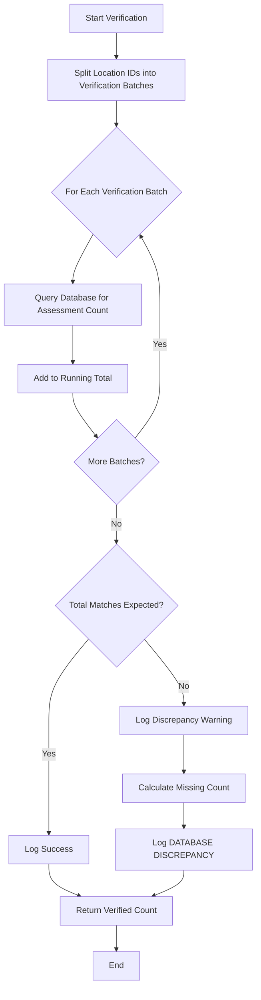

### Discrepancy Detection

- Compares processed count vs database count
- Logs `DATABASE DISCREPANCY DETECTED` if mismatch
- Indicates database write failures
- Critical for identifying timeout/transaction issues

---

## 10. Error Handling & Recovery

### Error Handling Strategy

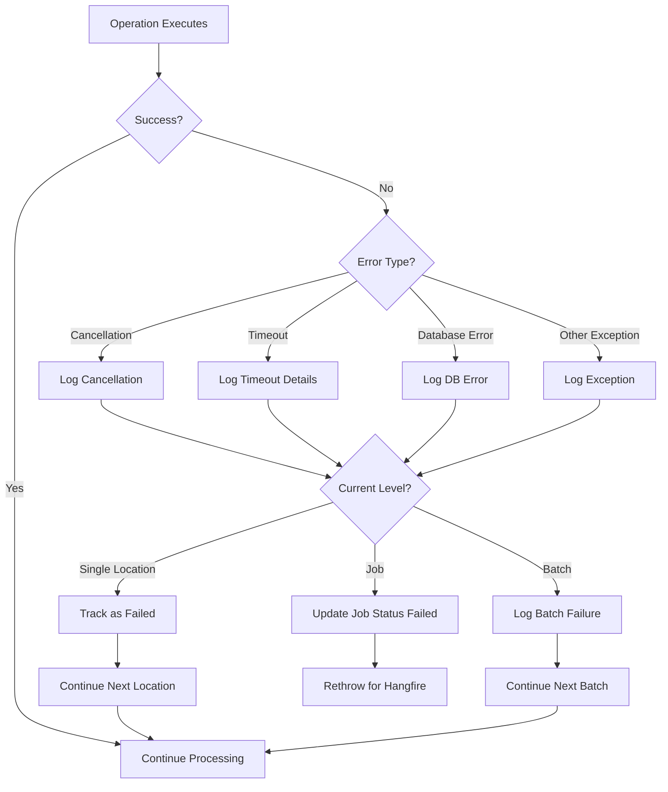

### Recovery Mechanisms

1. **Location-Level Failures**
   - Individual location errors don't stop batch
   - Failed locations tracked and reported
   - Processing continues with next location

2. **Batch-Level Failures**
   - Batch save failures logged with full context
   - Batch marked as failed
   - Processing continues with next batch

3. **Job-Level Failures**
   - Uncaught exceptions update job status to Failed
   - Full error details logged
   - No automatic retry (Attempts = 0)
   - Manual intervention required

---

## 11. Performance Optimizations

### Optimization Summary

| Optimization | Impact | Implementation |
|-------------|--------|----------------|
| Multi-level caching | 50-90% faster | 24h infra, 12h speed cache |
| Batch processing | 10-100x faster | Dynamic batch sizes |
| Subquery filtering | No timeout | Regional/Provincial |
| Envelope filtering | 2-5x faster | Municipal/Barangay |
| Wireless pre-computation | 1000x faster | R-Tree batch mode |
| Database aggregation | Prevents OOM | Large speedtest datasets |
| Memory management | Stable long jobs | GC every 5 batches |

### Caching Strategy

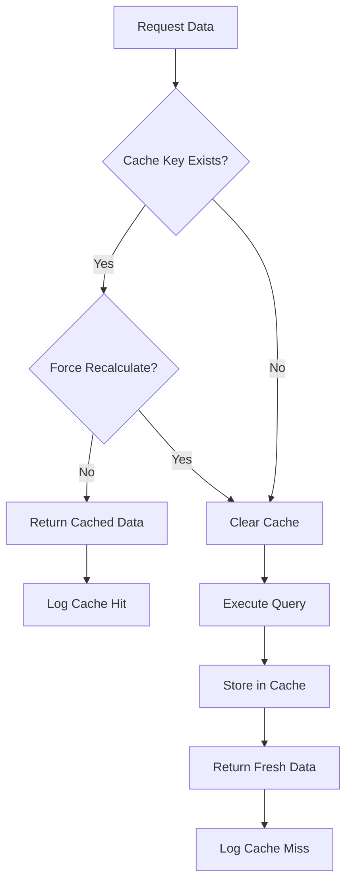

**Cache Keys:**
- Infrastructure: `infra:{locationType}:{locationId}` (24h)
- Speed: `speed:{locationType}:{locationId}` (12h)
- Technology: `tech:{locationType}:{locationId}` (24h)

---

## 12. Job Configuration

### Hangfire Attributes

```csharp
[Queue("connectivity-assessment")]           // Dedicated queue
[AutomaticRetry(Attempts = 0)]              // No retry, fail immediately
[DisableConcurrentExecution(timeout: 14400)] // 4 hours, no parallel runs
```

### Rationale

- **No Retry**: Prevents duplicate assessments, requires manual intervention
- **No Concurrency**: Prevents database exhaustion, ensures serialized execution
- **4 Hour Timeout**: Handles large hierarchical jobs (1000+ locations)

---

## 13. Progress Tracking

### Job Status Updates

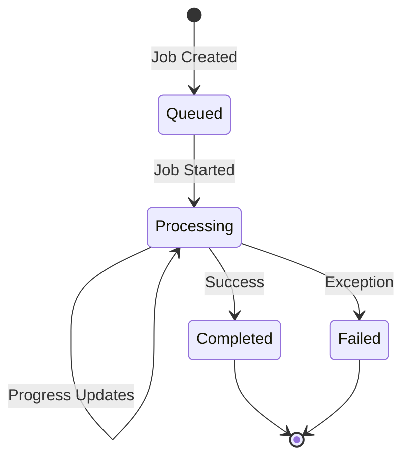

### Tracked Metrics

- **StartTime**: Job execution start
- **EndTime**: Job completion time
- **ProcessingCount**: Currently processing (optimistic)
- **ProcessedCount**: Successfully saved (pessimistic)
- **TotalCount**: Expected total locations
- **ProgressPercentage**: (ProcessedCount / TotalCount) × 100
- **Message**: Human-readable status
- **CurrentStep**: Processing phase description

---

## 14. Integration Points

### Input
- `ConnectivityAssessmentJobRequestDto`
  - Location IDs and types
  - Hierarchical processing settings
  - Date range filters
  - Force recalculate flag
  - User ID

### Output
- Updated `ConnectivityAssessment` records in database
- Updated `ConnectivityAssessmentProvider` records
- Job status updates in Hangfire

### Dependencies
- Location repositories (Region, Province, Municipality, Barangay)
- Infrastructure repositories (Cell, NAP, WiFi, Cellular, WirelessValidation)
- Speedtest repository
- WirelessCoverageComputationService
- Memory cache
- Entity Framework DbContext

---

## 15. Monitoring & Logging

### Key Log Messages

| Level | Message Pattern | Purpose |
|-------|----------------|---------|
| Info | Job started | Job initiation |
| Info | Processing {N} locations | Batch start |
| Info | Batch {X}/{Y} saved {N} | Batch completion |
| Warn | Cancellation requested | Job interruption |
| Error | Batch save TIMEOUT | Database timeout |
| Error | DATABASE DISCREPANCY | Persistence failure |
| Info | Job completed | Job success |

### Performance Metrics Logged

- Processing rate (items/second)
- Batch save duration
- Memory usage (every 5 batches)
- Cache hit/miss ratios
- Total job duration
- Success rate percentage

---

## 16. Common Issues & Solutions

| Issue | Symptom | Solution |
|-------|---------|----------|
| Batch save timeout | "Batch save TIMEOUT after 300s" | Reduce batch size |
| Missing assessments | "DATABASE DISCREPANCY DETECTED" | Check database locks/performance |
| Job cancellation | "Cancellation requested" | Check job timeout settings |
| Memory exhaustion | Slow processing, high memory | Reduce batch size, check GC |
| Slow queries | Long processing times | Check spatial indexes, optimize queries |

---

## 17. Testing Considerations

### Test Scenarios

1. **Single Location**: Process 1 barangay
2. **Small Batch**: Process 10 barangays
3. **Large Batch**: Process 100+ barangays
4. **Hierarchical**: Process region with 1000+ children
5. **Force Recalculate**: Override recent assessments
6. **Empty Data**: Locations with no infrastructure
7. **Timeout Simulation**: Very large regions
8. **Cancellation**: Mid-job termination

### Validation Checks

- All expected assessments created
- CMTS scores within 0-15 range
- Provider counts match infrastructure
- Wireless coverage JSON valid
- No duplicate assessments
- Timestamps accurate
- User context preserved
